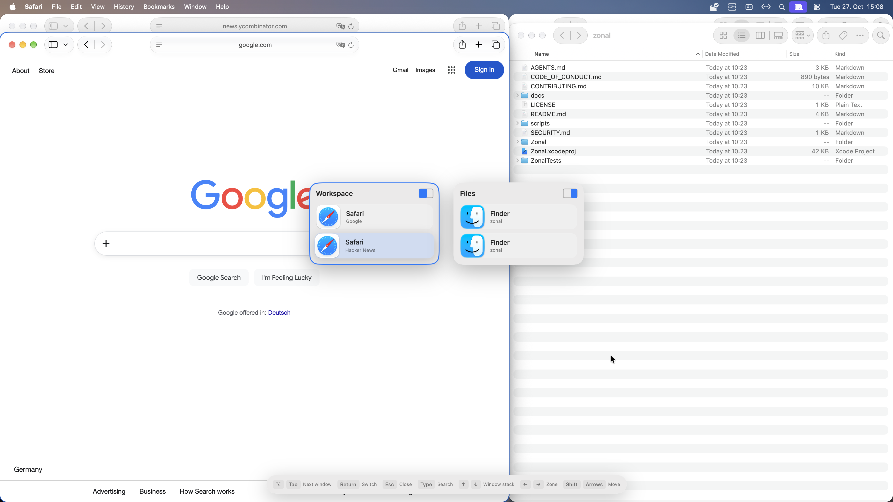
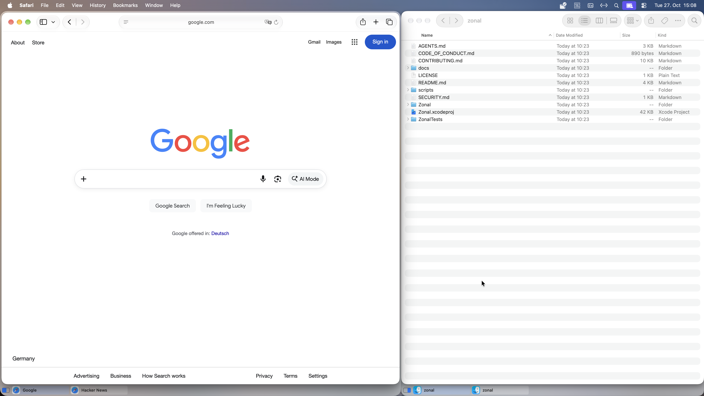
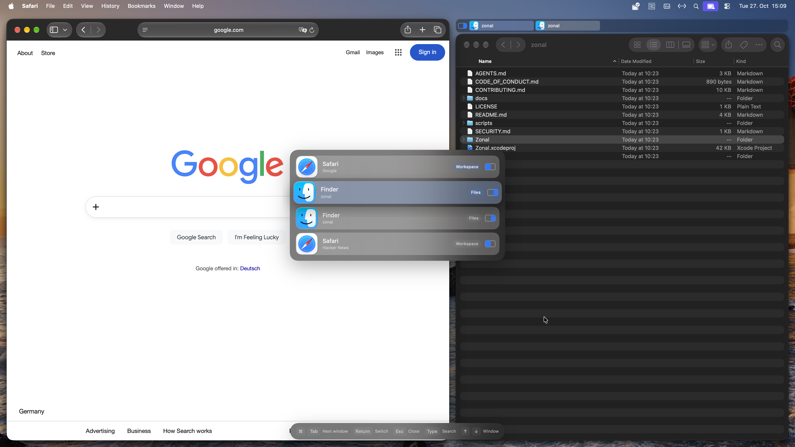
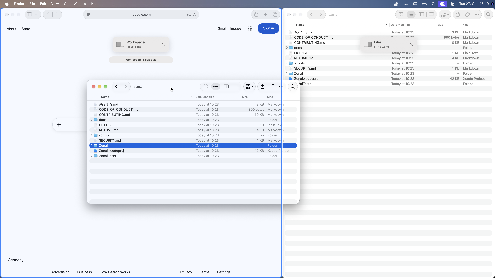

#  Zonal

Zonal is a macOS window manager for keeping several windows organized on one
screen—especially an ultrawide. Divide your display into zones, stack related
windows within each zone, and switch directly to the window you need.

- **Use an ultrawide as several work areas.** Keep your main task in the center,
  references on one side, and supporting windows on the other. Each zone can hold
  multiple windows with tabs or a peek stack.
- **Switch between windows from the same app.** Use Command–Tab to select an
  individual browser, editor, or document window, or cycle through just the
  windows in your current zone.
- **Keep several windows in one area.** Put reference documents or browser windows
  in a tabbed zone beside your main work. Choose Overlap, Peek stack, Tab shelf,
  or Tab frame independently for each zone.
- **Save layouts for different setups.** Keep an editor on one side and reference
  material on the other, or use overlapping zones. Save separate profiles for
  your laptop screen and external displays, with optional spacing between zones.
- **Keep window placement under control.** Fit windows to zones or retain custom
  sizes, move them between zones, and undo moves or size changes. Restore saved
  positions after your workspace gets rearranged; recovery does not reopen apps
  or documents.

Zonal is currently a **public beta**. It runs locally, without an account, analytics, or automatic crash uploads.

| Peek stacks | Tab frames |
| --- | --- |
| [](docs/images/peek.png) | [](docs/images/frames.png) |
| <ul><li>See stacked windows at a glance (Peek stack; 40 pt left, 20 pt right).</li><li>Switch between windows grouped by zone (By Zone switcher).</li></ul> | <ul><li>Select windows from tabs (Tab frame; bottom tabs).</li><li>Adjust the frame around each zone (4 pt left, 0 pt right; active-window outline off).</li></ul> |

| Overlap + tab shelf | Drag to assign |
| --- | --- |
| [](docs/images/overlap-panel.png) | [](docs/images/drag-to-assign.png) |
| <ul><li>Mix presentations across zones (Overlap left; Tab shelf right, tabs at the top).</li><li>Leave space between and around zones (16 pt spacing).</li><li>Switch across all windows (All Windows switcher).</li><li>Match your desktop’s appearance (dark mode; active-window outline off).</li></ul> | <ul><li>Move a window into a zone and resize it (drop on Fit to Zone).</li><li>Move a window while keeping its size (drop elsewhere in the zone).</li></ul> |

## Install

Download the latest **Zonal DMG** from [GitHub Releases](https://github.com/sebmarste/zonal/releases).
Open the disk image, drag **Zonal** onto **Applications**, then eject the disk image
and open Zonal from Applications. Release builds
are signed and notarized. Accept the normal macOS downloaded-app confirmation;
if macOS blocks it with a security error, report that message.

Zonal requires **macOS 26+**. Live testing has used Apple silicon on macOS 27.2
beta; macOS 26 and Intel runtime behavior remain unverified.

Setup asks for Accessibility and Input Monitoring permissions. Zonal handles
Command–Tab by default; choose **macOS Apps** in **Switching & Shortcuts** to opt out.

To update, quit Zonal before replacing it. Keep the old app and a copy of
`~/Library/Application Support/Zonal` for rollback: beta data formats can change,
and rollback needs the matching app and data. Invalid or unsupported data is
preserved rather than silently reset.

To uninstall, turn off **General → Launch Zonal at login**, quit, and remove the
app. Your layouts remain in Application Support unless you remove that folder too.

## Build and contribute

You need Xcode 27 with the macOS 27 SDK and Python 3.9+. No paid Apple account or
private signing credentials are required.

```sh
./scripts/build-dev
./scripts/check
```

Open `Zonal.xcodeproj` and run the **Zonal** scheme to launch. Quit the installed
copy first. Debug uses separate development data, but still controls real windows.

Bug fixes, useful regression tests, and documentation improvements are welcome.
For larger changes, open an issue first to discuss the problem. See
[contributing](CONTRIBUTING.md) for development, testing, and release details.

## Bugs and privacy

Use **Settings → Troubleshooting → Create Bug Report** to prepare a GitHub issue
with basic debug information. Review the draft, optionally append detailed
diagnostics, and submit it yourself. You can also [open an issue directly](https://github.com/sebmarste/zonal/issues/new).

Detailed diagnostics and crash reports may contain personal paths or window
information. Review them before sharing; never upload your entire Zonal data
folder. Opening a GitHub draft sends its text to GitHub and your browser history;
long drafts use the clipboard. Nothing is submitted automatically.

For private security or conduct reports, email **zonal@sebmarste.de**.
See the [security policy](SECURITY.md) and [code of conduct](CODE_OF_CONDUCT.md).

## License

[MIT](LICENSE). Free to use, modify, and share.
